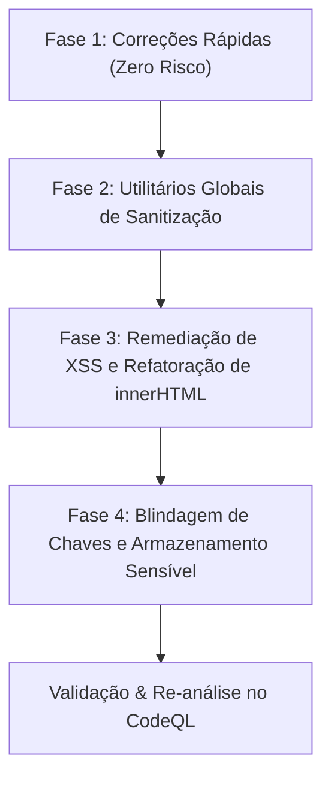

# Plano Estratégico de Melhoria de Qualidade de Código & Remediação CodeQL

> **Status da Autenticação na API do GitHub**: ✅ **Conectado com sucesso**  
> **Repositório**: `cparthur1/Flashcards`  
> **Data do Diagnóstico**: 19 de Outubro de 2026  
> **Total de Alertas Abertos no CodeQL**: **79 alertas** (70 de severidade Alta, 9 de severidade Média)

---

## 1. Visão Geral Executiva dos Achados

A análise do CodeQL no repositório identificou **79 vulnerabilidades e fragilidades de código** distribuídas em 8 regras principais. A grande maioria dos alertas concentra-se em três eixos centrais de segurança e higiene de código:

1. **Manipulação Insegura do DOM / Risco de XSS** (30 alertas combinados: 28 DOM XSS + 2 Exception XSS).
2. **Sanitização Incompleta de HTML por Regex de Passo Único** (22 alertas).
3. **Persistência de Dados Sensíveis e Chaves de API em Texto Puro** (20 alertas).

### Quadro Resumo por Categoria de Regra

| Regra CodeQL | Severidade | Qtd Alertas | Arquivos Mais Impactados |
| :--- | :---: | :---: | :--- |
| `js/xss-through-dom` | **Alta** | **28** | `js/game.js`, `js/generate.js`, `js/stats.js`, `js/index.js`, `js/engine/tutor.js` |
| `js/incomplete-multi-character-sanitization` | **Alta** | **22** | `js/game.js`, `js/stats-ai.js`, `js/stats-tracker.js`, `js/engine/tutor.js`, `js/generate.js` |
| `js/clear-text-storage-of-sensitive-data` | **Alta** | **20** | `js/game.js`, `js/key-manager.js`, `js/stats.js`, `js/generate.js`, `js/stats-tracker.js` |
| `js/insecure-randomness` | Média | 3 | `js/stats-ai.js`, `js/stats.js` |
| `js/xss-through-exception` | Média | 2 | `js/generate.js`, `js/stats.js` |
| `js/functionality-from-untrusted-source` | Média | 2 | `pages/game.html`, `pages/generate.html` |
| `actions/missing-workflow-permissions` | Média | 1 | `.github/workflows/dco.yml` |
| `js/incomplete-url-substring-sanitization` | Média | 1 | `js/utils.js` |

---

## 2. Diagnóstico Detalhado por Vulnerabilidade & Mecânica

### 2.1. Sanitização Incompleta de HTML (`js/incomplete-multi-character-sanitization`) — 22 Alertas
* **Exemplos**:
  - `js/engine/tutor.js:291` e `:294`: `description.replace(/<[^>]*>/g, '')`
  - `js/stats-tracker.js:216-217`: `q.description.replace(/<[^>]*>/g, '')`
  - `js/stats-ai.js:76-77`, `:126-127`, `:395`, `:399`, `:428`
  - `js/game.js:2524`, `:2537`, `:2554`, `:3586`, `:3671`
  - `js/generate.js:913`
* **Por que o CodeQL alerta**: A expressão regular `/<[^>]*>/g` executa uma única passagem substituindo tags HTML por string vazia. Entradas maliciosas contendo tags aninhadas (como `<<script>script>alert(1)<</script>/script>` ou ` src=x>`) têm apenas a tag interna removida na primeira passada, fazendo com que os caracteres restantes se unam formando uma nova tag `<script>` válida.
* **Impacto**: O texto que o sistema supõe estar "limpo" continua contendo código malicioso que pode ser repassado a contextos HTML ou prompts de IA.
* **Remediação Recomendada**: Criar uma função de utilitário centralizada `stripHtmlSafely(str)` em `js/utils.js` que aplique substituição recursiva em loop até estabilizar, ou que utilize um elemento DOM/DOMParser em memória para extração segura de `textContent`.

---

### 2.2. Injeção de Código no DOM (`js/xss-through-dom` & `js/xss-through-exception`) — 30 Alertas
* **Exemplos**:
  - `js/index.js:150`: `startBtn.innerHTML = \`<span class="material-symbols-rounded text-xl">folder_open</span> Abrir \${selectedFiles[0].name}\`;` (o nome do arquivo fornecido pelo usuário é interpolado diretamente no HTML).
  - `js/generate.js:2857` e `js/stats.js:1213`: Mensagens de erro (`err.message` / exceções) concatenadas diretamente em `.innerHTML`.
  - `js/game.js:251`, `:1133`, `:1135`, `:1251`, `:1860`, `:1882`, `:1889`, `:1893`, `:3409`, `:3419`, `:3467`.
  - `js/stats.js:354`, `:359`, `:1305`, `:1371`.
  - `js/engine/tutor.js:203`.
* **Por que o CodeQL alerta**: Dados originados de inputs do usuário, nomes de arquivos, mensagens de exceção ou conteúdos de cartões não confiáveis são atribuídos a propriedades `.innerHTML` sem codificação dos caracteres especiais (`&`, `<`, `>`, `"`, `'`).
* **Impacto**: Possibilidade de execução de scripts arbitrários (Cross-Site Scripting) no contexto do cliente.
* **Remediação Recomendada**:
  - Onde apenas texto é necessário: substituir `.innerHTML = ...` por `.textContent = ...`.
  - Onde ícones/tags são combinados com variáveis de texto: criar os elementos via DOM API (`document.createElement`, `span.textContent = fileName`) ou utilizar uma função `escapeHtml(str)`.
  - Em mensagens de erro (`catch (err)`): nunca interpolar `err.message` em `.innerHTML`.

---

### 2.3. Armazenamento em Texto Puro de Dados Sensíveis (`js/clear-text-storage-of-sensitive-data`) — 20 Alertas
* **Exemplos**:
  - `js/key-manager.js:228`: `sessionStorage.setItem(STORAGE_SESSION_KEY, cleanKey)`
  - `js/game.js:1911`, `:1919`, `:1930`, `:2545`, `:2562`, `:3089-3090`, `:3607`, `:3617`, `:3647`, `:3660`, `:3824`, `:3897`
  - `js/stats.js:1502`, `:1543`
  - `js/generate.js:2980`, `:2983`
  - `js/stats-ai.js:65`
  - `js/stats-tracker.js:51`
* **Por que o CodeQL alerta**: O analisador estático rastreia o fluxo de dados (*taint tracking*) de chamadas a `getItem` e nomes de variáveis contendo termos como `key`, `apiKey`, `token` ou objetos de estado de jogo completos gravados em `localStorage` e `sessionStorage`.
* **Impacto**: Se um script malicioso for executado no navegador (por exemplo via XSS em outra página do mesmo domínio), ele pode ler o `localStorage` e extrair a chave de API ou credenciais de sessão.
* **Remediação Recomendada**:
  - Centralizar todo o acesso à chave no `js/key-manager.js` mantendo a chave primariamente em memória (`inMemoryKey`).
  - Assegurar que objetos serializados em `flashcardsSave`, `flashcardsNotebook` e `editing_deck` nunca contenham campos de credenciais.
  - No `key-manager.js`, quando `remember` for falso, evitar persistir a chave mesmo em `sessionStorage`, ou ofuscar/cifrar com chave efêmera de sessão via Web Crypto.

---

### 2.4. Validação Incompleta de Substring de URL (`js/incomplete-url-substring-sanitization`) — 1 Alerta
* **Arquivo**: `js/utils.js:118`
* **Trecho atual**:
  ```javascript
  if (url.includes('generativelanguage.googleapis.com')) { ... }
  ```
* **Por que o CodeQL alerta**: `url.includes('...')` aceita URLs como `https://evil-generativelanguage.googleapis.com` ou `https://attacker.com?leak=generativelanguage.googleapis.com`.
* **Remediação Recomendada**:
  ```javascript
  try {
      const parsed = new URL(url, window.location.origin);
      if (parsed.hostname === 'generativelanguage.googleapis.com') { ... }
  } catch (e) {}
  ```

---

### 2.5. Permissões Excessivas no Workflow GitHub Actions (`actions/missing-workflow-permissions`) — 1 Alerta
* **Arquivo**: `.github/workflows/dco.yml:9`
* **Por que o CodeQL alerta**: O job `dco-check` não especifica o bloco `permissions:`, herdando as permissões padrão do repositório (que podem incluir escrita).
* **Remediação Recomendada**: Adicionar escopo de menor privilégio explícito no topo do workflow:
  ```yaml
  permissions:
    contents: read
    pull-requests: read
  ```

---

### 2.6. Scripts CDN sem Subresource Integrity (SRI) (`js/functionality-from-untrusted-source`) — 2 Alertas
* **Arquivos**:
  - `pages/game.html:43-48`
  - `pages/generate.html:35`
* **Por que o CodeQL alerta**: Scripts como `marked.min.js`, `katex.min.js`, `lz-string.min.js`, `qrcode.min.js` e `html5-qrcode` são carregados diretamente de CDNs externas sem os atributos `integrity="sha384-..."` e `crossorigin="anonymous"`.
* **Remediação Recomendada**: Adicionar o hash criptográfico SRI (`integrity`) em todas as tags `<script>` e `<link>` externas, ou hospedar cópias locais versionadas em `assets/vendor/` dentro do próprio repositório (garantindo também maior robustez offline/PWA).

---

### 2.7. Geração Insegura de Aleatoriedade (`js/insecure-randomness`) — 3 Alertas
* **Arquivos**: `js/stats-ai.js:115, 117`, `js/stats.js:662`
* **Por que o CodeQL alerta**: Uso de `Math.random()` para gerar identificadores únicos de sessão ou tokens de estado. `Math.random()` é previsível e não é criptograficamente seguro.
* **Remediação Recomendada**: Substituir por `crypto.getRandomValues(new Uint32Array(1))[0]` ou `crypto.randomUUID()`.

---

## 3. Roteiro de Implementação em 4 Fases



### 🎯 Fase 1: Correções Rápidas e Imediatas (Baixo Esforço, Zero Risco)
1. **GitHub Actions**:
   - Editar `.github/workflows/dco.yml` adicionando `permissions: contents: read, pull-requests: read`. *(Resolve Alert #138)*
2. **Validação de URL da API**:
   - Editar `js/utils.js:118` para validar `new URL(url).hostname === 'generativelanguage.googleapis.com'`. *(Resolve Alert #31)*
3. **Subresource Integrity (SRI)**:
   - Adicionar `integrity` e `crossorigin="anonymous"` aos scripts de CDN em `pages/game.html` e `pages/generate.html`. *(Resolve Alerts #17 e #35)*
4. **Aleatoriedade Criptográfica**:
   - Substituir `Math.random()` em geradores de IDs em `js/stats-ai.js` e `js/stats.js` por `crypto.randomUUID()` ou `crypto.getRandomValues()`. *(Resolve Alerts #81, #82, #83)*

---

### 🛡️ Fase 2: Arquitetura de Sanitização Centralizada
Implementar e exportar em `js/utils.js`:

```javascript
/**
 * Remove recursivamente todas as tags HTML prevenindo bypass por aninhamento
 */
export function stripHtml(input) {
    if (!input || typeof input !== 'string') return '';
    let sanitized = input;
    let prev;
    do {
        prev = sanitized;
        sanitized = sanitized.replace(/<[^>]*>/g, '');
    } while (sanitized !== prev);
    return sanitized.trim();
}

/**
 * Escapa meta-caracteres HTML para inserção segura em nós de texto
 */
export function escapeHtml(str) {
    if (!str || typeof str !== 'string') return '';
    return str
        .replace(/&/g, '&amp;')
        .replace(/</g, '&lt;')
        .replace(/>/g, '&gt;')
        .replace(/"/g, '&quot;')
        .replace(/'/g, '&#39;');
}
```

- Substituir todas as 22 ocorrências de `.replace(/<[^>]*>/g, '')` espalhadas por `js/game.js`, `js/stats-ai.js`, `js/stats-tracker.js` e `js/engine/tutor.js` pelo uso consistente de `stripHtml()`. *(Resolve os 22 alertas de `incomplete-multi-character-sanitization`)*.

---

### 🔒 Fase 3: Eliminação Sistemática de DOM XSS (28 Alertas)
1. **Tratamento de Exceções**:
   - Em `js/generate.js:2857` e `js/stats.js:1213`, substituir qualquer interpolação direta de `err.message` por `.textContent = err.message` ou `escapeHtml(err.message)`.
2. **Nomes de Arquivos e Inputs do Usuário**:
   - Em `js/index.js:150`, construir os nós do botão de upload via elementos nativos do DOM (`document.createElement`) ou sanitizar o nome com `escapeHtml(selectedFiles[0].name)`.
3. **Renderização de Perguntas e Respostas**:
   - Em `js/game.js` e `js/stats.js`, auditar os pontos de injeção em containers de feedback, títulos de baralhos e tabelas estatísticas, garantindo que textos livres de cartões não parseados como Markdown usem `.textContent`.

---

### 🔑 Fase 4: Blindagem de Chaves e Armazenamento
1. **Auditoria de `localStorage`**:
   - Revisar as funções `saveGameState()` em `js/game.js` para garantir que objetos de cartas não carreguem propriedades espúrias como credenciais de API.
2. **Isolamento de Segredos no `js/key-manager.js`**:
   - Assegurar que a chave nunca seja gravada em chaves legadas de `localStorage` em texto plano.
   - Utilizar cifragem AES-GCM via Web Crypto API (já estruturada no módulo) como único mecanismo de persistência local da chave.

---

## 4. Checklist de Validação Pós-Implementação

- [ ] Executar `node --check` em todos os módulos modificados (`js/utils.js`, `js/game.js`, `js/key-manager.js`, etc.).
- [ ] Submeter um commit com `git commit -s` seguindo as diretrizes de DCO.
- [ ] Acompanhar a execução da GitHub Action de CodeQL após o push.
- [ ] Re-executar o script de checagem da API de Code Scanning para verificar a redução dos 79 alertas para 0.
- [ ] Atualizar a versão de cache do Service Worker (`sw.js`) para propagar as melhorias de segurança aos usuários em PWA.
